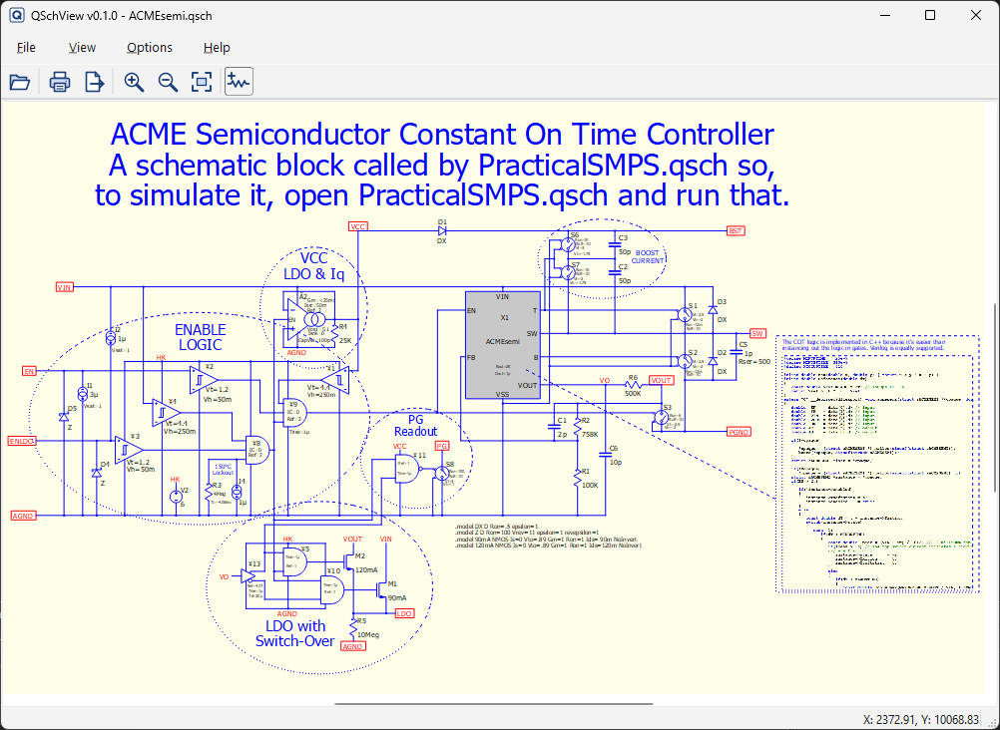
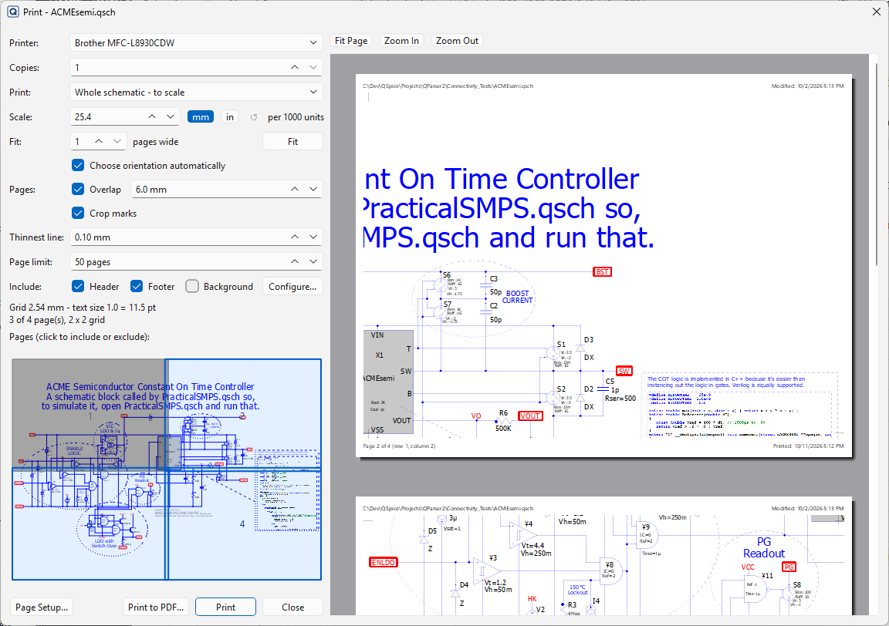
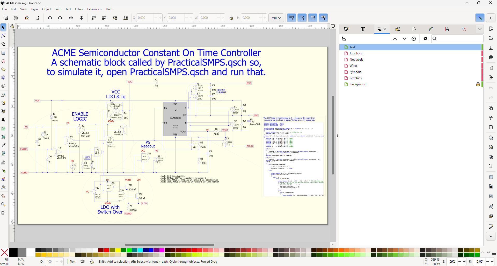

<h1>&nbsp; The QSchView Project</h1>

QSchView is a read-only viewer for QSpice schematics (`.qsch` files). It can show, print, and export them. It never changes or saves the schematic it shows.

The QSchView Project is a sub-project of The QParser2 Project. QSchView is a companion to QSchEdit, that project's schematic editor.

<hr>

<p align="center">
  <a href="images/Schematic_Loaded.png"></a>
  <a href="images/Print_Pages.png"></a>
  <a href="images/SVG_In_Inkscape.png"></a>
</p>

<hr>

<p align="center"><em>Click an image to see it full size.</em></p>

## Features

- **View:** One schematic per window, with mouse-wheel zoom and middle-button pan. Double-click a hierarchical block to open its schematic in a new window.
- **Print:** Fit the schematic to one page, or print it to scale across several pages. A live preview shows the result, with optional headers and footers.
- **PDF:** Write the schematic to a PDF file without a printer.
- **SVG:** Export a layered SVG file, ready for Inkscape or another SVG editor.
- **Command line:** Print and export without opening a window, for batch work.
- **QSpice colors:** When QSpice is installed, QSchView uses the colors QSpice is set to use. Without QSpice, it uses QSpice's standard colors. QSpice does not need to be installed.

QSchView does not simulate, netlist, or edit. It cannot open symbol files (`.qsym`) yet.

## Requirements

Windows 10 or later, 64-bit.

## Installing

1. Make an empty folder for QSchView somewhere you can write to, such as `C:\Tools\QSchView`. Avoid `C:\Program Files`, because QSchView keeps its settings beside the program.
2. Download the latest release, currently `QSchView_v0.1.0.zip`, from the [binaries](binaries) folder into that folder. Extract it and keep any sub-folders as they are.
3. Run `QSchView.exe`.

QSchView does not modify the Windows Registry. To remove it, delete its folder.

The help file, `QSchView_Help.pdf`, is included in the zip. In the program, open it with Help > QSchView Help (F1).

## Command line

```
QSchView FILE.qsch [--print[=PRINTER]] [--pdf=FILE] [--svg=FILE]
                   [--fit | --scale=MM] [--orientation=O] [--paper=P]
                   [--header | --no-header] [--footer | --no-footer]
                   [--background | --no-background] [--copies=N]
QSchView --list-printers | --help | --version
```

Example:  `QSchView Amp.qsch --pdf=Amp.pdf --fit --orientation=auto`

Add the QSchView folder to the Windows PATH to run it from any folder. The help file lists every option and result code.

## Building from source

The [sources](sources) folder holds QSchView's sources. Building them needs Microsoft Visual Studio 2026 and Qt 6. QSchView is built with Qt 6.11.2, MSVC, x64.

## License

QSchView is licensed under the [GNU General Public License version 3 (GPL-3.0)](https://www.gnu.org/licenses/gpl-3.0.html).

QSchView uses the Qt framework, which has its own licenses. The Qt libraries in the binaries zip are the unmodified open-source Qt 6.11.2 libraries, used under the [GNU Lesser General Public License version 3 (LGPL-3.0)](https://www.gnu.org/licenses/lgpl-3.0.html). Qt sources and licensing details are available from [The Qt Company](https://www.qt.io/download-open-source). See also [Qt Licensing](https://doc.qt.io/qt-6/licensing.html).

## Support

Post questions to @RDunn on the [QSpice forum](https://forum.qorvo.com/c/qspice/9) at Qorvo.
